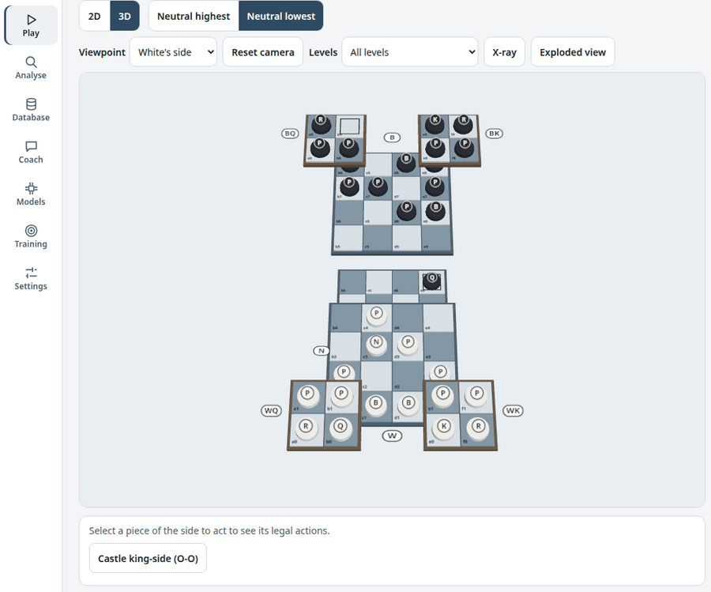
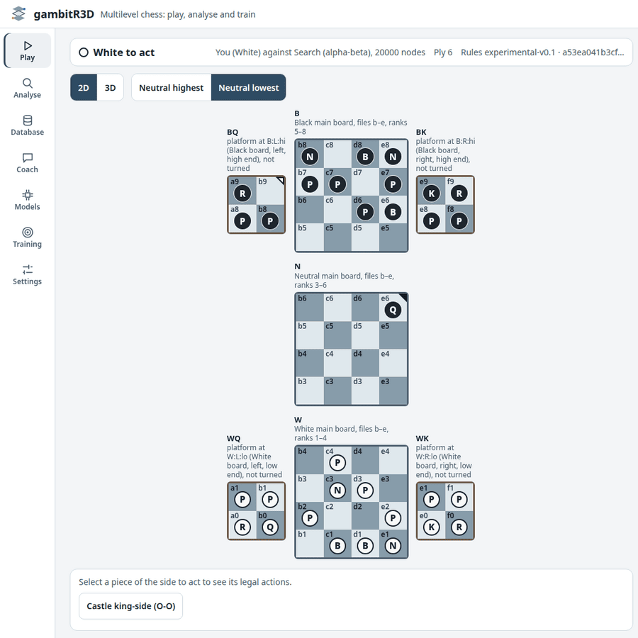
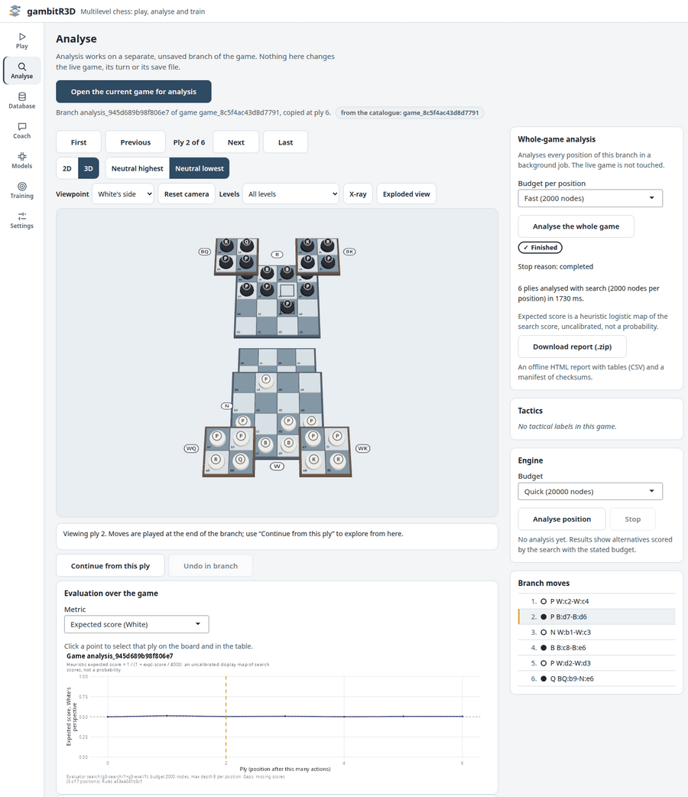
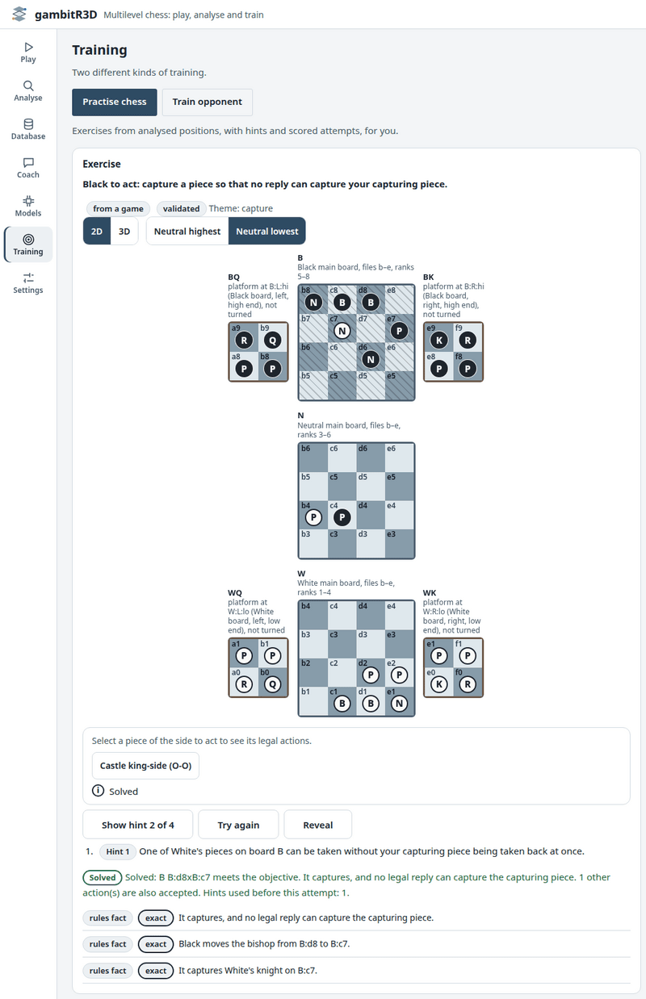

# gambitR3D 

<!-- badges: start -->
[](https://github.com/r-heller/gambitR3D/actions/workflows/R-CMD-check.yaml)
<!-- badges: end -->

Multilevel chess in R: play, analyse and train.

gambitR3D implements an experimental multilevel chess variant on three fixed
4×4 boards (White, Neutral, Black) and four movable 2×2 platforms. There are 64
physical squares, and each keeps its identity when a platform moves. The
package covers the whole loop:

- a rules engine, with a compiled port that gives identical results;
- a local app with synchronised 2D and 3D views;
- a game database, game and collection analysis, and engine-grounded
  coaching with exercises;
- an optional, isolated PyTorch worker that trains and plays a small
  transformer.

Play, analysis, the database and coaching run on your computer, offline and
without an account. Python is needed only to train a model or play against
one. Setting it up downloads the pinned packages once.

The rules are an experimental project convention (`experimental-v0.1`), not
an official rulebook. Where the source concept left a rule open, the profile
records a proposed resolution in a ledger of 18 decisions, and
`vignette("rules")` lists them. gambitR3D is a companion to gambitR; its
functions use the prefix `g3_`.

| Play in 3D | The same position in 2D |
|---|---|
|  |  |

## Installation

```r
# install.packages("remotes")
remotes::install_github("r-heller/gambitR3D")
# or from a local copy of the source:
remotes::install_local("path/to/gambitR3D")
```

The package compiles C++ code, so it needs a compiler: Rtools on Windows,
Xcode command line tools on macOS. The app also needs the suggested packages
shiny, bslib, htmltools and callr; the plots need ggplot2.

```r
install.packages(c("shiny", "bslib", "htmltools", "callr", "ggplot2", "viridisLite"))
```

## The app

```r
gambitR3D::g3_run_app()
```

The app listens on `127.0.0.1` only. In the app you can:

- play hotseat, or against the alpha-beta search, a baseline or a trained
  model;
- switch between 2D and 3D, and show the Neutral board highest or lowest,
  without changing the game;
- analyse a copy of the game, browse the game database, review the game with
  the coach, and practise exercises with graded hints.

`vignette("app")` gives the tour.



## In R

```r
library(gambitR3D)

game <- g3_new_game(players = list(white = "Ada", black = "Computer"))
head(g3_legal_actions(game$state)[, c("action_id", "label")])

game <- g3_game_apply(game, "m:W:1:1-N:1:1")
reply <- g3_choose_action(game$state, agent = "search", budget = list(nodes = 20000L))
reply$label
game <- g3_game_apply(game, reply$action_id)

g3_write_game(game, "my-game.g3.json")   # replayed and checksummed on reading
```

Action ids name physical squares as `board:u:v`, so `W:b3` and `N:b3` are
never confused. A game file stores the initial state and every event, and
reading it replays each event through the rules.

### Database and analysis

```r
db <- g3_open_game_db("games.sqlite")
g3_save_game(db, game)
g3_query_games(db)[, c("game_id", "status", "white", "black", "plies")]

res <- g3_analyse_game(game, budget = list(nodes = 2000L))
g3_plot_game(res)                          # needs ggplot2
g3_export_analysis_report(res, "report")   # offline HTML, CSV tables, manifest
g3_close_game_db(db)
```

Importing goes through quarantine: a record that fails to replay is set aside,
with the first invalid event, and never enters the catalogue. Scores are in
the search's heuristic units, from the side to act's point of view. The
expected score is a display map of that score; it is not calibrated, and the
plots and reports say so.

### Coaching and practice

```r
st <- g3_new_game()$state
g3_explain_action(st, "m:W:0:0-N:1:0")$text
g3_explain_action(st, "m:W:0:0-N:1:0", lang = "de")$text

review <- g3_coach_game(game, budget = list(nodes = 3000L))
exs <- g3_create_exercises(review, max_n = 5L)
```

Every coaching claim comes from the engine and carries its strength: a rules
fact, an exact search result, or a heuristic. Exercises are marked
"validated" only after the criterion has been checked against every legal
action.



### Training a model (optional)

Training uses a separate Python 3.12 environment with CPU-only PyTorch. It is
built with `uv` from a pinned lock with hashes, currently resolved for Linux
x86_64. The package never touches it on load.

```r
env <- file.path(tools::R_user_dir("gambitR3D", "data"), "ml-env")
g3_setup_ml(env)            # about 820 MB installed; reports versions and schema match
options(gambitR3D.ml_env = env)
```

`vignette("training")` walks through a bounded run within the smoke limits
(at most 512 positions, 20 steps, 600 seconds and 2 threads): data generated
by the rules engine, training, an exact resume from a checkpoint, a legal move
by the trained model, and self-play. Such a run checks the pipeline; it does
not make a strong opponent. Published models for ordinary chess are listed for
reference only, because they cannot play this variant.

## Guides

| Guide | Topic |
|---|---|
| `vignette("gambitR3D")` | getting started |
| `vignette("rules")` | the rules profile and the decision ledger |
| `vignette("app")` | the app, the 2D and 3D views |
| `vignette("database")` | import, query, export, backup |
| `vignette("analysis")` | positions, games, collections, plots, reports |
| `vignette("coaching")` | reviews, hints, exercises, the learner profile |
| `vignette("models")` | the model registry and the training environment |
| `vignette("training")` | a bounded training run |
| `vignette("experiments")` | comparing agents fairly |
| `vignette("extending")` | architecture and extension points |

## Status and limits

This is a first release of an experimental variant. The numbers below were
measured on one Linux machine.

- **Engine.** The compiled engine and the R reference agreed on the legal
  actions of 3,500 positions and on 240 complete searches. This was checked
  during development and again in an independent audit; the test suite
  repeats a smaller sample on every run. The search
  visits about 130,000 positions a second, so 100,000 positions take
  about 0.8 s.
- **Search strength.** It was measured only against weak baselines: in 144
  games against the random and greedy agents, the search won all 128
  completed games, and 16 games reached the ply cap. Piece values for this
  variant are unknown, and the evaluation is a heuristic.
- **Ratings.** There are none. The package reports expected scores with
  bootstrap intervals over paired starting positions, never Elo.
- **Models.** A model trained within the smoke limits only shows that the
  pipeline works.
- **App testing.** The browser tests ran in headless Chrome on Linux. Other
  browsers, touch devices and screen readers have not been tested.
- **Model play.** Each move against a model starts a model worker, which takes
  a few seconds.
- **Not supported.** The package reads and writes no FEN or PGN, because
  neither can describe platforms. Games have no clocks.

## Contributing

See [CONTRIBUTING.md](CONTRIBUTING.md). Browser tests run with
`GAMBITR3D_BROWSER_TESTS=true`; model tests need `G3_ML_ENV` pointing at a
training environment.

## Licence

MIT © Raban Heller. The bundled three.js 0.186.1 is MIT licensed; its
provenance and file hashes are listed in
`inst/app/www/vendor/PROVENANCE.md`.
